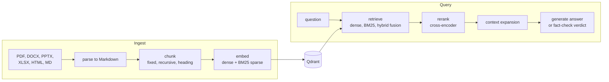
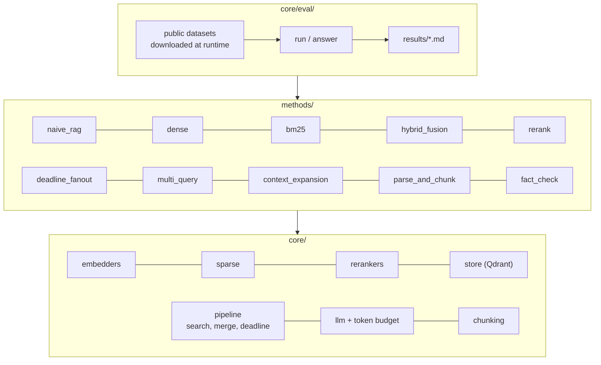
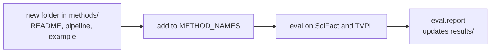

# production-rag

"Production" here means the methods come from production use, from naive to advanced RAG. Each one is written up next to runnable code and measured on public data. This is a lab to read and try methods in, not a deployable service.

## How it fits together



Each box is a method folder under [`src/production_rag/methods/`](src/production_rag/methods/), built on shared parts in `core/`. Every method has a `README.md` that explains it, a `pipeline.py` and an `example.py`.



## Results

Headline numbers only. Every table links to the full results, with all metrics and run notes. Latency is in-process on CPU (Apple silicon, one query at a time).

### Retrieval

nDCG@10, with p50 latency in brackets. SciFact: English scientific claims (300 queries, 5,183 documents). TVPL: Vietnamese legal questions (1,000 sampled queries, 10,576 documents).

| Method | SciFact | TVPL |
|---|---|---|
| `naive_rag` (800-char chunks) | 0.751 (22 ms) | 0.815 (23 ms) |
| `dense` | 0.762 (21 ms) | **0.818** (22 ms) |
| `bm25` | 0.683 (7 ms) | 0.669 (7 ms) |
| `hybrid_rrf` | 0.755 (23 ms) | 0.786 (26 ms) |
| `hybrid_weighted_rrf` | **0.769** (23 ms) | 0.808 (26 ms) |
| `hybrid_rrf_rerank` | 0.660 (985 ms) | 0.810 (812 ms) |

Full tables, with recall, MRR, p95 and the BM25 and fusion variants: [SciFact](results/scifact.md), [TVPL](results/tvpl.md), and for `naive_rag` [SciFact](results/scifact_naive_rag.md), [TVPL](results/tvpl_naive_rag.md).

### Answer quality

Each method retrieves the top 5 passages and `gpt-5.4-nano` answers from them. The same model, acting as an LLM judge, scores correctness against the gold answer. Run 2026-11-12.

| Method | mini_wiki correctness | vi_legal correctness |
|---|---|---|
| `naive_rag` | 0.797 | 0.620 |
| `hybrid_fusion` | 0.813 | 0.580 |
| `rerank` | 0.823 | 0.630 |
| `multi_query` | 0.817 | 0.610 |
| `context_expansion` | 0.830 | 0.685 |

Correctness moved by up to 0.07 between two runs, so smaller gaps are noise. The judge is the same model that answers. The `vi_RAG` gold answers were aligned with LLMs. Full tables, with faithfulness, abstention, latency and tokens: [mini_wiki](results/answer_mini_wiki.md), [vi_legal](results/answer_vi_legal.md).

### Chunking, parsing and fact check

| Experiment | Result | Full results |
|---|---|---|
| Chunking (dense only, nDCG@10) | fixed 800: 0.751 / 0.815; recursive 800: 0.750 / 0.810; recursive 800 + 200 overlap: 0.750 / 0.802; recursive 400: 0.743 / 0.794 (SciFact / TVPL) | [SciFact](results/scifact_chunking.md), [TVPL](results/tvpl_chunking.md) |
| Parsing (token recall / precision, 15 public files) | all 0.954 / 0.959; pdf 0.982 / 0.920; xlsx recall 0.629 against docling's own output | [parse quality](results/parse_quality.md) |
| Fact check (300 SciFact claims) | accuracy 0.703 and 0.740 over two runs; refuted recall 0.375 in run 1 | [run 1](results/fact_check_scifact.md), [runs compared](results/fact_check_scifact_runs.md) |

### What stands out

- IDF matters: BM25 without it loses 0.03 to 0.08 nDCG@10. A general Vietnamese stopword list makes BM25 worse on legal questions ([BM25](src/production_rag/methods/bm25/README.md)).
- Weighted RRF (dense 1.0, sparse 0.5) is the best hybrid on both sets. On TVPL, dense alone is still slightly better ([hybrid fusion](src/production_rag/methods/hybrid_fusion/README.md)).
- The multilingual cross-encoder helps on Vietnamese legal questions and hurts on English scientific claims, at about 1 s per query on CPU ([rerank](src/production_rag/methods/rerank/README.md)).
- On answers, the methods are within run-to-run variance on mini_wiki. On vi_legal, `context_expansion` scores highest but sends about twice the passage tokens and has the lowest faithfulness ([context expansion](src/production_rag/methods/context_expansion/README.md)).
- Fan-out under a 150 ms deadline skips the rerank spec on every query and answers in 22 ms p50, against 366 ms at 2000 ms ([deadline fan-out](src/production_rag/methods/deadline_fanout/README.md)).
- Fixed 800-character chunks are best or tied on both sets, and a 200-character overlap does not help ([parse and chunk](src/production_rag/methods/parse_and_chunk/README.md)).
- Fact check: 25 of 64 refuted claims got `unverified` in run 1 ([fact check](src/production_rag/methods/fact_check/README.md)).

## Methods

| Folder | Variants (eval names) | Extra | What it does |
|---|---|---|---|
| [`naive_rag`](src/production_rag/methods/naive_rag/README.md) | `naive_rag` | `local-models` + `OPENAI_API_KEY` | Fixed 800-char chunks, dense top 5, one prompt, generate |
| [`dense`](src/production_rag/methods/dense/README.md) | `dense` | `local-models` | Jina v5 nano embeddings |
| [`bm25`](src/production_rag/methods/bm25/README.md) | `bm25_no_idf`, `bm25`, `bm25_vi_stopwords` | none for search | BM25 without IDF, with IDF, and with Vietnamese stopwords removed first |
| [`hybrid_fusion`](src/production_rag/methods/hybrid_fusion/README.md) | `hybrid_rrf`, `hybrid_dbsf`, `hybrid_weighted_rrf` | `local-models` | Dense + BM25 fused in Qdrant: reciprocal rank fusion, distribution-based score fusion, RRF with dense weighted 2:1 |
| [`rerank`](src/production_rag/methods/rerank/README.md) | `hybrid_rrf_rerank` | `local-models` | Hybrid RRF, then a cross-encoder over the top candidates |
| [`deadline_fanout`](src/production_rag/methods/deadline_fanout/README.md) | none | `local-models` | Deadline budget and spec fan-out; latency bench in its README |
| [`multi_query`](src/production_rag/methods/multi_query/README.md) | none | `local-models` | Multi-query merge; answer numbers in its README |
| [`context_expansion`](src/production_rag/methods/context_expansion/README.md) | none | `local-models` | Neighbour chunks or the full document around each hit; answer numbers in its README |
| [`parse_and_chunk`](src/production_rag/methods/parse_and_chunk/README.md) | `chunk_recursive_800`, `chunk_recursive_800_o200`, `chunk_recursive_400` | `parse` + `local-models` | PDF, DOCX, PPTX, XLSX, HTML, Markdown to Markdown with pip-only parsers; fixed, recursive and heading-aware chunking |
| [`fact_check`](src/production_rag/methods/fact_check/README.md) | none | `local-models` + `OPENAI_API_KEY` | claims from a statement, evidence per claim, verdict: supported, refuted, unverified; `not_relevant` when nothing is checkable |

## Quickstart

```bash
docker compose up -d qdrant
uv sync --extra local-models --extra eval

# index SciFact and score two methods (downloads the dataset)
uv run python -m production_rag.core.eval.run --dataset scifact --methods bm25 hybrid_fusion --query-limit 20 --name smoke

# run one method's example
uv run python -m production_rag.methods.hybrid_fusion.example

# answer eval (calls an LLM): estimate first, then run with a token cap
export OPENAI_API_KEY=...
uv run python -m production_rag.core.eval.answer --dataset mini_wiki --sample 20 --estimate-only
uv run python -m production_rag.core.eval.answer --dataset mini_wiki --sample 20 --max-tokens 400000

# parsing quality on public PDF and Office files (no LLM)
uv run --extra parse python -m production_rag.methods.parse_and_chunk.parse_eval

# chunking comparison (retrieval only, downloads the dataset)
uv run python -m production_rag.core.eval.run --dataset scifact --methods naive_rag parse_and_chunk --name scifact_chunking
# the same for the TVPL table: add --dataset tvpl and --name tvpl_chunking

# fact check (calls an LLM): estimate first, then a small capped run
uv run --extra eval --extra local-models python -m production_rag.methods.fact_check.eval --sample 30 --estimate-only
uv run --extra eval --extra local-models python -m production_rag.methods.fact_check.eval --sample 30 --max-tokens 100000
```

Estimate the tokens before every LLM run and give every LLM run a cap.

As a library:

```python
import asyncio

from production_rag.core.config import Settings
from production_rag.core.deps import build_deps, warm_up
from production_rag.core.llm import OpenAIChat, TokenBudget
from production_rag.methods.hybrid_fusion import pipeline as hybrid_fusion
from production_rag.methods.naive_rag import pipeline as naive_rag


async def main() -> None:
    deps = build_deps(Settings.from_env())
    await warm_up(deps)
    await naive_rag.index(deps, "docs", {"d1": (None, "...")})
    llm = OpenAIChat.from_env(budget=TokenBudget(5_000))
    out = await naive_rag.answer("...", "docs", deps, llm)
    print(out.text)
    # retrieval only
    hits = await hybrid_fusion.search("...", "docs", deps)
    print(hits.rows)


asyncio.run(main())
```

## Adding a method



1. Add a folder under `src/production_rag/methods/` with `README.md`, `pipeline.py` and `example.py`. `pipeline.py` exports `VARIANTS`, `DEFAULT` and `search`.
2. Add the name to `METHOD_NAMES` in `src/production_rag/methods/__init__.py`.
3. A new vector kind or backend goes in `core/`.
4. Run the eval on both datasets, then `python -m production_rag.core.eval.report`.

## Tests

```bash
uv run pytest                              # no network, no Qdrant, no extras
uv run --extra local-models pytest -m integration
```

## Roadmap

Next: query rewrite and speculative search, LLM rerank, cache, semantic chunking, embedding comparison, `cpu_embedding_batching`, testset generation, chunking compared on answer quality. Known gaps: [`BACKLOG.md`](BACKLOG.md).

## Models, data and licenses

- Dense: [`jinaai/jina-embeddings-v5-text-nano-retrieval`](https://huggingface.co/jinaai/jina-embeddings-v5-text-nano-retrieval), CC-BY-NC-4.0 (non-commercial). Swap it through the [`Embedder`](src/production_rag/core/embedders/base.py) protocol or point `EMBEDDING_BASE_URL` at an OpenAI-compatible `/embeddings` endpoint.
- Sparse: fastembed `Qdrant/bm25`. Rerank: [`cross-encoder/mmarco-mMiniLMv2-L12-H384-v1`](https://huggingface.co/cross-encoder/mmarco-mMiniLMv2-L12-H384-v1).
- Vietnamese stopwords: [stopwords/vietnamese-stopwords](https://github.com/stopwords/vietnamese-stopwords), MIT.
- LLM for generation and judging: OpenAI, default `gpt-5.4-nano`, set with `OPENAI_MODEL`.
- Answer eval data: [rag-datasets/rag-mini-wikipedia](https://huggingface.co/datasets/rag-datasets/rag-mini-wikipedia) (`cc-by-3.0` per its card, Wikipedia text) and the `LegalRAG` config of [DuyTa/vi_RAG](https://huggingface.co/datasets/DuyTa/vi_RAG) (`apache-2.0` per its card; the id now redirects to sailor2/Vietnamese_RAG; its answers were aligned with LLMs per the card). VLQA is not used because it is not released yet.
- Datasets are downloaded at runtime and not stored here: [BeIR/scifact](https://huggingface.co/datasets/BeIR/scifact) and [GreenNode/TVPL-Retrieval-VN](https://huggingface.co/datasets/GreenNode/TVPL-Retrieval-VN), both CC-BY-SA-4.0.
- Parse extra: `pdfplumber`, `python-docx`, `python-pptx`, `openpyxl`, `markdownify` and `beautifulsoup4`, all MIT.
- Parsing eval data: 7 arXiv papers (CC BY 4.0, except `arxiv-1602.06541v2`, CC BY-SA 4.0) with the [py-pdf/benchmarks](https://github.com/py-pdf/benchmarks) ground truth (BSD-3-Clause, pinned commit `18ee8c4`), and the [docling](https://github.com/docling-project/docling) test fixtures (MIT, pinned commit `a7760ab`). Downloaded at runtime, not stored here.
- Fact-check data: [SciFact](https://huggingface.co/datasets/allenai/scifact) claims, CC BY-NC 2.0 (non-commercial) per the card, downloaded at runtime from allenai's release tarball and not stored here.

Code: MIT.
