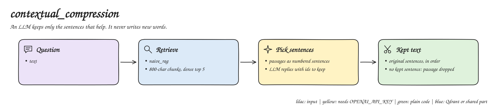

<div align="center">

# Contextual compression

**Send only the sentences that help answer the question.**

</div>

<p align="center"></p>

| | |
|---|---|
| **Stage** | Context |
| **Extra** | `local-models` |
| **LLM** | at query time (`OPENAI_API_KEY`) |
| **Eval variants** | answer eval only (`contextual_compression` front end) |
| **Compare with** | [`context_expansion`](../context_expansion/README.md): that one adds text around a hit, this one removes text from it. The context-compaction use case of the decision-models post by Aurimas Griciunas (score each piece of context and drop the stale ones instead of summarising) is close to this: sentences are kept by id and never rewritten |
| **Headline** | 88% fewer passage tokens on mini_wiki and 72% on vi_legal, with correctness within noise of `naive_rag` (0.800 / 0.562 against 0.810 / 0.575) |

## When to use
- Retrieved passages are long and mostly off-topic, so the prompt pays for tokens that do not help the answer.

## When not to
- Passages are already short (one or two sentences), or the answer needs the surrounding text: the extra LLM call costs more than it saves, and a trimmed passage can lose context the answer needs.

## How it works
- [`compress.py`](compress.py): after retrieval, one LLM call gets the question and every retrieved passage split into numbered sentences (`[1.1]`, `[1.2]`, `[2.1]`, ...) and replies with the ids to keep (JSON, capped at 256 tokens). The text that comes back is always the original sentences, in their original order, joined with a space; the model never writes new words. A passage with no kept sentence is dropped.
- Fallback: a reply that cannot be used, a failed call, an empty list or no valid id returns the passages whole. `BudgetExceeded` propagates.
- [`pipeline.py`](pipeline.py): retrieval is [`naive_rag`](../naive_rag/README.md) (fixed 800-character chunks, dense top 5), then `compress`.
- Retrieval does not change, so there is no retrieval row: nDCG@10 would be the same as the method it sits on. It is measured only in the answer eval, as the `contextual_compression` front end.

Sources: Xu et al., [RECOMP: Improving Retrieval-Augmented LMs with Compression and Selective Augmentation](https://arxiv.org/abs/2310.04408) (2023), and the contextual compressor pattern of LangChain. Own prompt, reimplemented from the descriptions.

## Run

```bash
OPENAI_API_KEY=... uv run --extra local-models python -m production_rag.methods.contextual_compression.example
```

Without a key the example prints the passages before compression and says so.

## Results
Run 2026-11-16, `gpt-5.4-nano` answers and judges, top 5 passages, on a sample to fit this project's 5M token budget: 50 mini_wiki questions and 40 vi_legal questions (237,236 and 417,636 tokens). Correctness moved by up to 0.07 between two runs of the earlier answer eval, so smaller gaps are noise. `Retrieval p50 ms` includes the compression call, and `RAG tokens / question` includes its tokens. Full tables: [mini_wiki](../../../../results/contextual_compression_mini_wiki.md), [vi_legal](../../../../results/contextual_compression_vi_legal.md).

| Method | mini_wiki correctness | mini_wiki passage tokens | vi_legal correctness | vi_legal passage tokens | RAG tokens / question (mini_wiki / vi_legal) |
|---|---|---|---|---|---|
| `naive_rag` | 0.810 | 769 | 0.575 | 1186 | 641 / 1228 |
| `context_expansion` | 0.860 | 957 | 0.662 | 2651 | 764 / 2526 |
| `contextual_compression` | 0.800 | 96 | 0.562 | 336 | 963 / 1811 |

Compression cuts the passages sent to the generator by 88% on mini_wiki and 72% on vi_legal, with correctness within noise of `naive_rag`. The compression call itself reads every passage, so total tokens per question go up, not down, and it adds about 1 s at p50.
