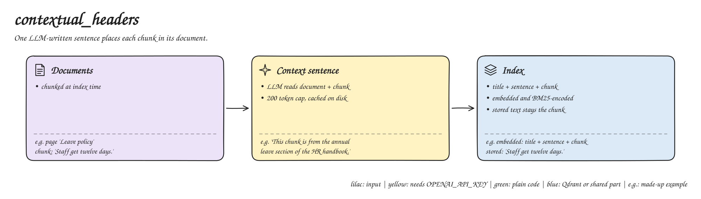

<div align="center">

# Contextual headers

**A context sentence for every chunk, written by an LLM at index time.**

</div>

<p align="center"></p>

| | |
|---|---|
| **Stage** | Ingest |
| **Extra** | `local-models` |
| **LLM** | at index time (`OPENAI_API_KEY`) |
| **Eval variants** | `contextual_headers`, against `chunk_recursive_800` |
| **Headline** | No clear difference on a 100-query sample: nDCG@10 0.919 / 0.969 against 0.928 / 0.967 (SciFact / TVPL) |

The title prefix and the heading path already exist in the repo: `core/indexing.py` embeds every chunk as `title + "\n" + text`, and the `markdown` chunker prefixes each chunk with its heading path ([`chunking.py`](../../core/chunking.py)). This method adds only the part that is new: one LLM-written sentence per chunk. The baseline in the table is those existing title-only chunks.

## When to use
- Chunks lose their subject once they are cut out of the document: "Staff get twelve days." says nothing about leave without the page around it.

## When not to
- Documents are short or every chunk already names its subject. The sentence costs one LLM call per chunk at index time and adds nothing.

## How it works
- [`context.py`](context.py): for each chunk, the LLM reads the document and the chunk and writes one short sentence that places the chunk in the document (plain text, capped at 200 tokens, in the document's language). A document longer than 12,000 characters is cut there before it goes into the prompt.
- The sentence is embedded and BM25-encoded together with the title and the chunk. The stored and returned text stays the raw chunk, so reranking, display and generation are unchanged.
- Results are cached on disk under `.cache/llm` (git-ignored), keyed by model, prompt and input text, so a rerun costs no tokens. A failed or empty generation leaves that chunk without context and is not cached. `BudgetExceeded` propagates, and what was already generated stays cached.
- A collection that already holds every chunk is reused as is, so delete it after changing the chunking or the prompt. If any chunk gets no context sentence (a failed call), `index` raises `ContextIncomplete` and writes nothing, so a half-contextual collection is never kept; fix the cause and rerun, and the cache supplies what was already generated.
- [`pipeline.py`](pipeline.py): `index(deps, llm, cache, collection, docs, size=800)` chunks the documents (recursive, 800 characters), adds the context and indexes them; `search` searches that collection with the `chunk_recursive_800` configuration (dense).

Source: Anthropic, [Introducing Contextual Retrieval](https://www.anthropic.com/news/contextual-retrieval) (2024). Own prompt, reimplemented from the description.

## Run

```bash
OPENAI_API_KEY=... uv run --extra local-models python -m production_rag.methods.contextual_headers.example
```

Without a key the example says so and stops.

## Results
Run 2026-11-16, `gpt-5.4-nano`, on a sample: 100 queries, all their gold documents, and random other documents up to 350 on SciFact and 500 on TVPL. A full run is about 11.9M tokens on SciFact alone, over this project's 5M budget. Both rows use recursive 800-character chunks and dense search; only the context sentence differs. Full tables: [SciFact](../../../../results/contextual_headers_scifact.md), [TVPL](../../../../results/contextual_headers_tvpl.md).

| Method | SciFact ndcg@10 | SciFact recall@10 | TVPL ndcg@10 | TVPL recall@10 |
|---|---|---|---|---|
| `chunk_recursive_800` | 0.928 | 0.960 | 0.967 | 0.990 |
| `contextual_headers` | 0.919 | 0.960 | 0.969 | 0.993 |

No clear difference. A small corpus makes retrieval easy (recall@10 is 0.96 or more on every row), so this sample cannot show a gain. Indexing costs one LLM call per chunk: 860 chunks on SciFact, 874 on TVPL. The first run cut about 1 in 5 Vietnamese sentences at a 100-token cap, so the cap is now 200.
