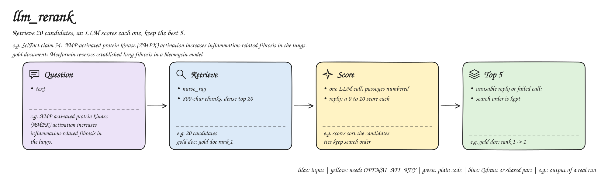

<div align="center">

# LLM rerank

**Retrieve 20 candidates, have an LLM score each one, keep the best 5.**

</div>

<p align="center"></p>

| | |
|---|---|
| **Stage** | Rerank |
| **Extra** | `local-models` |
| **LLM** | at query time (`OPENAI_API_KEY`) |
| **Eval variants** | retrieval eval `llm_rerank` (`core/eval/run_llm.py`), next to `naive_rag` |
| **Compare with** | [`rerank`](../rerank/README.md): that one scores with a local cross-encoder, this one asks an LLM |
| **Headline** | nDCG@10 0.768 / 0.849 against `naive_rag` 0.751 / 0.815 (SciFact / TVPL), at about 1.9 s per query |

## When to use
- A cheap first-stage search puts the right passage in the top 20 but not in the top 5, and one LLM call per query is affordable.

## When not to
- Latency or cost per query matters more than ranking quality: a local cross-encoder (`rerank`) adds no LLM call.
- The first stage already ranks the right passage near the top.

## How it works
- [`rerank.py`](rerank.py): one LLM call gets the question and every candidate passage, numbered, and replies with a score from 0 to 10 per passage (JSON, capped at 512 tokens). The passages are sorted by score; two passages with the same score keep their search order.
- The score is the model's own judgement, not a calibrated probability. It is only used to sort.
- Fallback: a reply that cannot be used (not JSON, a passage missing or repeated, an id or score out of range, a reply cut at the cap, a failed call) returns the passages in their search order. `BudgetExceeded` propagates.
- [`pipeline.py`](pipeline.py): candidates are the top 20 of [`naive_rag`](../naive_rag/README.md) (fixed 800-character chunks, dense), then `rerank`, then the first `k`.

## Run

```bash
uv run --extra local-models python -m production_rag.methods.llm_rerank.example
```

Without `OPENAI_API_KEY` the example prints the search results and stops.

## Results

300 SciFact claims against 5,183 abstracts and 1,000 TVPL questions against 10,576 documents, `gpt-5.4-nano`, run 2026-11-22, one run each, no failed query. Full tables: [`results/scifact_llm.md`](../../../../results/scifact_llm.md), [`results/tvpl_llm.md`](../../../../results/tvpl_llm.md). Latency is in-process on CPU and includes the LLM call.

| Method | SciFact nDCG@10 | TVPL nDCG@10 | p50 (SciFact / TVPL) | Tokens (SciFact / TVPL) |
|---|---|---|---|---|
| `naive_rag` | 0.751 | 0.815 | 81 / 82 ms | 0 |
| `llm_rerank` | 0.768 | 0.849 | 1,955 / 1,892 ms | 941,593 / 4,099,748 |

### Notes

- recall@10 is 0.877 against 0.875 on SciFact and 0.928 against 0.917 on TVPL; MRR@10 is 0.736 against 0.715 and 0.835 against 0.794. The gain is in the order of the top results, not in what is found.
- recall@100 is lower (0.883 against 0.962, 0.938 against 0.977) because only the 20 candidates come back, so a document outside the top 20 is lost.
- Each dataset was run once. The SciFact difference of 0.017 nDCG@10 may be noise; run-to-run spread was not measured.
- The LLM call dominates latency: about 1.9 s per query against 80 ms for `naive_rag`.
