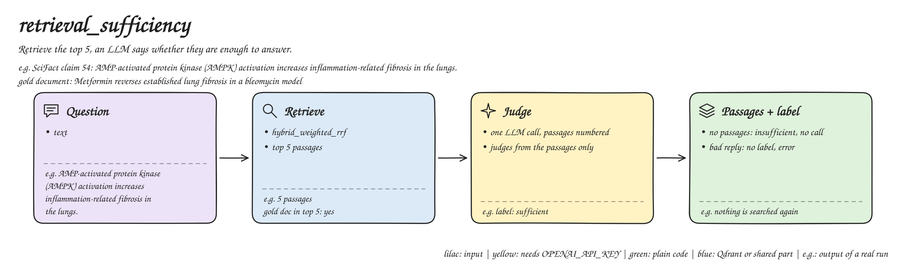

<div align="center">

# Retrieval sufficiency

**Retrieve the top 5, then ask an LLM: is this enough to answer the question?**

</div>

<p align="center"></p>

| | |
|---|---|
| **Stage** | Verify |
| **Extra** | `local-models` |
| **LLM** | at query time (`OPENAI_API_KEY`) |
| **Eval variants** | own eval, `production_rag.methods.retrieval_sufficiency.eval` |
| **Compare with** | [`fact_check`](../fact_check/README.md): that one judges a claim against evidence, this one judges whether retrieval found enough for a question |
| **Headline** | `sufficient` labels were right about a gold document 93% (SciFact) and 95% (TVPL) of the time; agreement with the proxy 0.513 / 0.862 |

## When to use
- Something downstream must decide whether to answer, search again or say "not found", and it needs a cheap signal on the retrieved passages before generation.

## When not to
- You need the answer itself: the label says nothing about what the answer is.
- Retrieval always returns whole documents far longer than a few passages: the prompt grows with them.

## How it works
- [`judge.py`](judge.py): one LLM call gets the question and the passages, numbered, and replies `sufficient` or `insufficient` (JSON, capped at 64 tokens). The model judges only from the passage text.
- The label is the model's own judgement, not a calibrated probability.
- No passages is `insufficient` with no LLM call. A reply that cannot be used (not JSON, a label outside the two, a reply cut at the cap, a failed call) has no label and an error; the passages are still returned. `BudgetExceeded` propagates.
- [`pipeline.py`](pipeline.py): the passages come from `hybrid_weighted_rrf` (`base`, top `k` = 5), then `judge_sufficiency`. Nothing is searched again when the label is `insufficient`.

## Run

```bash
OPENAI_API_KEY=... uv run --extra local-models python -m production_rag.methods.retrieval_sufficiency.example
```

Without a key the example says so and stops.

## Results

300 SciFact claims against 5,183 abstracts and 1,000 TVPL questions against 10,576 documents, top 5 of `hybrid_weighted_rrf`, `gpt-5.4-nano`, run 2026-11-23, one run each, no failed query (514,405 and 1,788,419 tokens). Full tables: [`results/retrieval_sufficiency_scifact.md`](../../../../results/retrieval_sufficiency_scifact.md), [`results/retrieval_sufficiency_tvpl.md`](../../../../results/retrieval_sufficiency_tvpl.md).

The datasets have no sufficiency label, so the eval uses a proxy: `sufficient` should mean a gold document is in the top 5. The proxy is not a measure of whether the passages answer the question.

| | SciFact | TVPL |
|---|---|---|
| Gold document in the top 5 | 84.3% | 90.3% |
| Labelled `sufficient` | 41.7% | 84.3% |
| Agreement with the proxy | 0.513 | 0.862 |
| `sufficient` and gold found / not found | 116 / 9 | 804 / 39 |
| `insufficient` and gold found / not found | 137 / 38 | 99 / 58 |

### Notes

- When the model says `sufficient`, a gold document is in the top 5 in 116 of 125 (SciFact) and 804 of 843 (TVPL) cases.
- It is stricter than the proxy on SciFact: of the 253 queries with a gold abstract in the top 5, it calls 137 `insufficient`. A SciFact claim is a statement to verify, and the model may want more than one abstract to say so. On TVPL it calls 99 of 903 such queries `insufficient`.
- Each dataset was run once; run-to-run spread was not measured.
