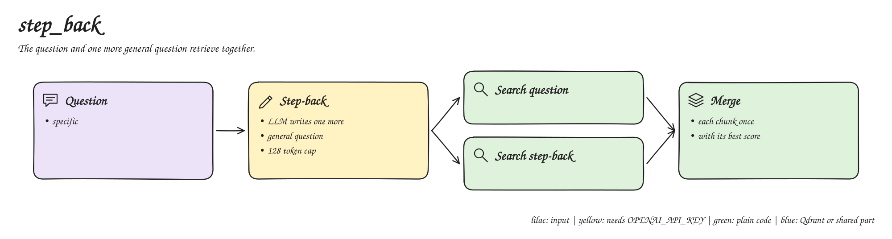

<div align="center">

# Step-back

**Search the question and one more general question.**

</div>

<p align="center"></p>

| | |
|---|---|
| **Stage** | Query rewrite |
| **Extra** | `local-models` |
| **LLM** | at query time (`OPENAI_API_KEY`) |
| **Eval variants** | `step_back` |
| **Compare with** | [`multi_query`](../multi_query/README.md): one deliberately more abstract question, not several rephrasings at the same level of detail |
| **Headline** | On SciFact +0.008 nDCG@10 and +0.019 recall@10 over `hybrid_weighted_rrf`; on TVPL 0.005 below it |

## When to use
- A specific question needs background that a more general passage holds, for example "why did the 1929 crash hit German banks" and a passage on the causes of the Great Depression.

## When not to
- The question is already general, or the answer sits in one specific passage: the extra query only adds noise to the merge.

## How it works
- [`generate.py`](generate.py): the LLM writes one more general question (JSON, capped at 128 tokens). Any bad output, or a step-back that repeats the question, gives the question alone, so search still runs. `BudgetExceeded` propagates.
- [`pipeline.py`](pipeline.py): `search` is the `multi_query` search. The question and the step-back question each retrieve on their own, then each chunk is kept once with its best score. The default base is `hybrid_weighted_rrf`.

Source: Zheng et al., [Take a Step Back: Evoking Reasoning via Abstraction in Large Language Models](https://arxiv.org/abs/2310.06117) (2023). Own prompt, reimplemented from the paper.

## Run

```bash
OPENAI_API_KEY=... uv run --extra local-models python -m production_rag.methods.step_back.example
```

Without a key the example searches the question and says so.

## Results
Run 2026-11-13, `gpt-5.4-nano`, one run per dataset with all the LLM query rows together (318,658 tokens on SciFact, 1,280,815 on TVPL). The same baseline moved by about 0.002 nDCG@10 between two runs with no code change, so smaller differences are noise. Full tables: [SciFact](../../../../results/query_side_scifact.md), [TVPL](../../../../results/query_side_tvpl.md).

| Method | SciFact ndcg@10 | SciFact recall@10 | TVPL ndcg@10 | TVPL recall@10 | p50 ms (SciFact / TVPL) |
|---|---|---|---|---|---|
| `hybrid_weighted_rrf` | 0.770 | 0.888 | 0.808 | 0.919 | 148 / 68 |
| `multi_query` | 0.775 | 0.879 | 0.809 | 0.918 | 1374 / 1394 |
| `step_back` | 0.778 | 0.907 | 0.803 | 0.916 | 1217 / 1272 |

On SciFact, `step_back` is +0.008 nDCG@10 and +0.019 recall@10 over `hybrid_weighted_rrf`. On TVPL it is 0.005 below it.
